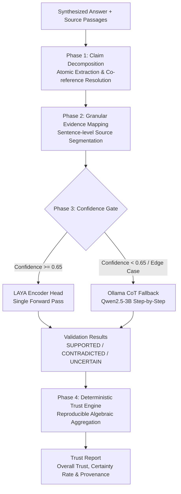

# VeridexAI

<p align="center">
  <strong>Private, Autonomous AI Answer Engine with an Independent, Real-Time Claim Verification Subsystem</strong>
</p>

<p align="center">
  
  
  
  
  
  
</p>

---

## 📖 Executive Summary

Large Language Models (LLMs) frequently hallucinate, generate inaccurate citations, and exhibit confirmation bias when asked to self-evaluate their own outputs. At the same time, conventional post-hoc evaluation pipelines often prompt secondary large generative models to evaluate every extracted statement—introducing high latency, stochastic evaluation variance, and notable inference costs.

**VeridexAI** pairs a private, search-augmented answer engine with an **independent, structurally decoupled claim verification subsystem**. When an answer is synthesized from retrieved web passages, an isolated verification engine dissects the text into atomic claims, maps each claim to exact source sentence segments, evaluates natural language entailment using a hybrid encoder-first scoring head, and computes an inspectable, deterministic trust score.

> **Important Conceptual Distinction:** The VeridexAI Trust Score is a **deterministic algebraic aggregation of model verdicts and confidence scores against retrieved source text**. It is an auditable measure of *evidence-grounded consistency*—not an ontological guarantee that a statement represents objective ground truth.

---

## ⚡ Architectural Highlights

* 🛡️ **Independent Verification (Generator–Verifier Decoupling):** Generation and verification execute in isolated processes communicating only over a typed JSON contract. The verifier audits only the final answer and raw retrieved passages, eliminating generator prompt-leakage and self-grading bias *(note: architectural independence prevents self-evaluation bias, though the verifier remains bounded by source quality and model classification limits)*.
* ⚡ **Non-Autoregressive Fast Path:** For high-throughput verification, claims are evaluated via **LAYA (ModernBERT / mmBERT)**, an encoder-only classification head that predicts directional entailment in a single forward pass without autoregressive token generation overhead.
* 🔀 **Confidence-Gated Hybrid Routing:** The scoring pipeline implements a decision gate. When the encoder head yields a confidence score $\ge 0.65$, the verdict is accepted immediately. Ambiguous or low-confidence edge cases are selectively escalated to local Chain-of-Thought (CoT) reasoning via Ollama (`qwen2.5:3b`).
* 🎯 **Exact Evidence Provenance:** Rather than passing entire articles or generative summaries to the user, claims are paired with exact sentence-level identifiers (`source_id:segment_index`), highlighting the precise original source text.
* 📐 **Deterministic, Inspectable Trust Engine:** The composite Trust Score is calculated via fixed arithmetic rules rather than a secondary LLM meta-review. The calculation is fully reproducible, transparent, and verifiable by hand.
* 🔒 **Local & Privacy-Preserving by Default:** When operating with local Ollama models and the bundled SearXNG engine, searches, data scraping, and claim verification run entirely on the local machine with zero external API calls or user tracking. (Commercial frontier models like Claude, GPT, or Gemini remain optional via user API keys).

---

## 🏛️ System Architecture

VeridexAI comprises two loosely-coupled subsystems:

```
┌────────────────────────────────────────────────────────────────────────┐
│                        GENERATION SUBSYSTEM                            │
│  Next.js 16 App Router • React 19 • Electron • Bundled SearXNG Engine  │
│  - Metasearch retrieval across 7+ engines                              │
│  - Playwright headless extraction & Readability parsing                │
│  - Token budgeting & prompt assembly                                  │
│  - Multi-provider model dispatch (Ollama / Claude / OpenAI / Gemini)   │
└──────────────────────────────────┬─────────────────────────────────────┘
                                   │ Synthesized Text + Raw Source Segments
                                   ▼ [POST /api/verify → JSON StdIO Bridge]
┌────────────────────────────────────────────────────────────────────────┐
│               INDEPENDENT VERIFICATION SUBSYSTEM                       │
│              Python 3.10+ • LAYA • ModernBERT • Ollama                 │
│                                                                        │
│   Phase 1: Claim Decomposition & Co-Reference Decontextualization      │
│   Phase 2: Granular Sentence Segmentation & Evidence Mapping           │
│   Phase 3: Hybrid Confidence-Gated Neural Scoring Head                 │
│   Phase 4: Deterministic Algebraic Trust Aggregation                   │
└──────────────────────────────────┬─────────────────────────────────────┘
                                   │ Structured Verdicts & Provenance
                                   ▼
┌────────────────────────────────────────────────────────────────────────┐
│                   INTERACTIVE USER TRUST PANEL                         │
│  - Sentence-level citation chips with drill-down modals                │
│  - Directional claim badges (SUPPORTED / CONTRADICTED / UNCERTAIN)     │
│  - Auditable Trust Index breakdown & evidence certainty coverage       │
└────────────────────────────────────────────────────────────────────────┘
```

---

## 🔬 Deep-Dive: Claim Verification & Trust Engine

The verification engine in [`verification/`](verification/) executes a four-phase pipeline:



### Phase 1: Claim Decomposition & Decontextualization
* **File:** [`verification/claim_decomposer.py`](verification/claim_decomposer.py)
* Raw model answers often concatenate multiple factual assertions and employ anaphoric references ("He later founded it in 1976...").
* The decomposer splits prose into atomic, single-fact assertions and resolves entity pronouns, ensuring each claim is **self-contained** before entering verification.

### Phase 2: Exact Evidence Segmentation & Provenance Mapping
* **File:** [`verification/evidence_mapper.py`](verification/evidence_mapper.py)
* Web pages retrieved by SearXNG and Playwright are split into discrete sentence segments.
* Each atomic claim is mapped to the most relevant source segments, creating candidate pairs:
  $$\langle \text{Claim}_i, \text{Evidence}_j \rangle$$
* The original text of the source is strictly preserved; the verifier never paraphrases or synthesizes evidence passages.

### Phase 3: Hybrid Confidence-Gated Neural Scoring Head
* **Files:** [`verification/laya_scorer.py`](verification/laya_scorer.py), [`verification/claim_validator.py`](verification/claim_validator.py)
* Each claim-evidence pair is classified into a 3-way directional entailment verdict:
  * **`SUPPORTED`**: The supplied evidence directly confirms or logically entails the claim.
  * **`CONTRADICTED`**: The supplied evidence directly refutes or conflicts with the claim.
  * **`UNCERTAIN`**: The supplied evidence is ambiguous, incomplete, or insufficient to reach a verdict.

#### Supported Execution Backends:
1. **`laya` (Encoder-only):** Uses ModernBERT / mmBERT fine-tuned for claim entailment. Executes non-autoregressively without token-by-token generation overhead.
2. **`ollama` (Generative LLM):** Uses local Ollama (`qwen2.5:3b`) with structured JSON schema output to evaluate claims step-by-step.
3. **`hybrid` (Confidence-Gated, Recommended):** Runs LAYA first. If the model confidence falls below $0.65$, the claim is escalated to Ollama for chain-of-thought verification.

### Phase 4: Deterministic Algebraic Trust Aggregation
* **File:** [`verification/trust_engine.py`](verification/trust_engine.py)
* The final Trust Report does not rely on a generative model to summarize findings. Instead, it computes an algebraic, inspectable metric:

1. **Signed Confidence per Claim ($s_i$):**
   $$s_i = \begin{cases} +c_i & \text{if } \text{label} = \text{SUPPORTED} \\ -c_i & \text{if } \text{label} = \text{CONTRADICTED} \\ 0.0 & \text{if } \text{label} = \text{UNCERTAIN} \end{cases}$$
   *(where $c_i \in [0.0, 1.0]$ represents model confidence).*

2. **Weighted Raw Trust Score:**
   $$\text{Raw Score} = \frac{\sum_{i=1}^{N} w_i \cdot s_i}{\sum_{i=1}^{N} w_i} \quad \in [-1.0, +1.0]$$

3. **Normalized Trust Index:**
   $$\text{Overall Trust} = \frac{\text{Raw Score} + 1.0}{2.0} \quad \in [0.0, 1.0] \quad (\text{displayed as } 0\% - 100\%)$$

4. **Evidence Certainty Coverage:**
   $$\text{Certainty Coverage} = \frac{\sum_{i \notin \text{UNCERTAIN}} w_i \cdot c_i}{\sum_{i=1}^{N} w_i}$$

---

## ⚖️ Design Choices and Architectural Trade-offs

| Design Decision | Approach in VeridexAI | Alternative Approaches (e.g. FActScore, SAFE, RARR) | Trade-offs & Considerations |
|---|---|---|---|
| **Claim Entailment Model** | **Non-autoregressive encoder head** (ModernBERT / LAYA) with optional generative fallback. | **Large Autoregressive LLM prompts** for every claim. | **VeridexAI:** Drastically lower inference latency and fixed compute costs. However, smaller encoder heads may struggle with deeply nested multi-step reasoning without generative escalation. |
| **Trust Aggregation** | **Deterministic arithmetic formula** on signed confidences. | **Generative LLM meta-judge** evaluating the entire document. | **VeridexAI:** 100% reproducible and auditable by third parties. However, simple arithmetic treats claim weights equally by default unless domain weights are explicitly supplied. |
| **Ambiguity Representation** | **Three-way classification** (`SUPPORTED` / `CONTRADICTED` / `UNCERTAIN`). | **Binary True / False** forced choice. | **VeridexAI:** Prevents hallucinated false positives on partial evidence. Claims with insufficient evidence do not penalize trust as contradictions. |
| **Evidence Extraction** | **Exact sentence-segment attribution** with immutable IDs. | **Generative quote extraction or summarization**. | **VeridexAI:** Full provenance guarantees the user sees unaltered source text. However, sentence segmentation boundaries must be cleanly parsed to avoid truncated clauses. |
| **Decontextualization** | **Entity co-reference resolution** in Phase 1 before scoring. | **Evaluating raw sentences in isolation**. | **VeridexAI:** Solves dangling pronouns ("it", "they"). Adds a small decomposition step before validation begins. |

---

## 🛠️ Complete Tech Stack

```
VeridexAI/
├── Generation Subsystem (Frontend & Answer Engine)
│   ├── Framework: Next.js 16 (App Router), React 19, TypeScript
│   ├── Styling: Tailwind CSS, Headless UI, Lucide Icons, Framer Motion
│   ├── Desktop Wrapper: Electron 43+, Node.js child_process
│   ├── Search Backend: Embedded SearXNG metasearch engine (auto-managed)
│   ├── Scraper & Parser: Playwright headless browser, Mozilla Readability, JSDOM
│   ├── Token Budgeting: js-tiktoken
│   └── Local Storage: SQLite (via better-sqlite3 & Drizzle ORM)
│
└── Verification Subsystem (Independent Evaluator)
    ├── Core Runtime: Python 3.10+
    ├── Fast Entailment Head: LAYA (ModernBERT / mmBERT)
    ├── Generative Fallback: Ollama (`qwen2.5:3b`) via local REST API
    ├── Subprocess Transport: JSON Standard I/O bridge (`verification/bridge.py`)
    └── API Handler: `src/app/api/verify/route.ts`
```

---

## 🚀 Step-by-Step Quick Start

### 1. Prerequisites
* **Node.js**: `v20.x` or `v22.x` (LTS recommended)
* **Yarn**: `v1.22+` (`corepack enable` or `npm install -g yarn`)
* **Python**: `3.10`, `3.11`, or `3.12`
* **Ollama**: Installed and running from [ollama.com](https://ollama.com)

---

### 2. Clone the Repository
```bash
git clone https://github.com/Blueturboguy07/veridex.git
cd veridex
```

---

### 3. Set Up Node Dependencies
```bash
yarn install
```

---

### 4. Set Up Python Virtual Environment
Always install the verification dependencies in an isolated virtual environment:

```bash
# Create a virtual environment named .venv
python -m venv .venv

# Activate the virtual environment
# Windows (PowerShell):
.\.venv\Scripts\Activate.ps1
# macOS / Linux:
source .venv/bin/activate

# Install verification dependencies
pip install --upgrade pip
pip install -r verification/requirements.txt
```

---

### 5. Prepare Local Ollama Model
Ensure Ollama is running in the background (`ollama serve`). Pull the model used for claim decomposition and fallback reasoning:

```bash
ollama pull qwen2.5:3b
```
Verify the model responds:
```bash
ollama run qwen2.5:3b "Hello"
```

---

### 6. Configure Environment Variables (`.env.local`)
Create a `.env.local` file in the root directory:

```env
# Verification backend: 'hybrid' (default), 'laya', or 'ollama'
VERIFICATION_BACKEND=ollama

# Specify the python executable inside your virtual environment
# Windows example:
PYTHON_EXECUTABLE=.\.venv\Scripts\python.exe
# macOS / Linux example:
# PYTHON_EXECUTABLE=./.venv/bin/python
```

> **Backend Selection Tip:**
> * If you have PyTorch installed and want the fastest throughput, leave `VERIFICATION_BACKEND=hybrid` or `laya`. On the first run, the LAYA weights (~400MB) will automatically download from Hugging Face to your local cache (`~/.cache/huggingface/`).
> * If you want a lightweight setup without installing PyTorch/LAYA, set `VERIFICATION_BACKEND=ollama`.

---

### 7. Run the Application

#### Option A: Web Development Server
```bash
yarn dev
```
**What happens under the hood:**
1. `scripts/start-dev.mjs` starts the embedded **SearXNG** metasearch process and writes the local connection port to `config.json`.
2. Next.js starts on `http://localhost:3000`.
3. When you run a query, the answer engine generates the response.
4. When verification is requested, Next.js spawns `python -m verification.bridge` using your specified virtual environment Python binary.

#### Option B: Desktop (Electron) Mode
To run VeridexAI as a native desktop application:
```bash
yarn app
```
*(This compiles Next.js with Webpack and launches the local Electron window).*

---

## 🔍 Standalone Verification CLI / Contract Testing

You can execute and test the verification pipeline directly from the command line without running Next.js:

```bash
# Activate your venv
.\.venv\Scripts\Activate.ps1

# Run the bridge with a test JSON payload
python -m verification.bridge < verification/sample_payload.json
```

### Sample Input Payload:
```json
{
  "query": "Who founded Apple and when?",
  "answer": "Apple was founded in 1976 by Steve Jobs, Steve Wozniak, and Ronald Wayne.",
  "sources": [
    {
      "content": "Apple Inc. was founded on April 1, 1976, by Steve Jobs, Steve Wozniak, and Ronald Wayne in Los Altos, California.",
      "title": "History of Apple - Wikipedia",
      "url": "https://en.wikipedia.org/wiki/History_of_Apple"
    }
  ],
  "backend": "hybrid"
}
```

### Sample Output Response:
```json
{
  "claims": [
    {
      "claim_id": "c1",
      "claim": "Apple was founded in 1976.",
      "label": "SUPPORTED",
      "confidence": 0.96,
      "evidence": [
        {
          "source_id": "s0",
          "text": "Apple Inc. was founded on April 1, 1976...",
          "url": "https://en.wikipedia.org/wiki/History_of_Apple"
        }
      ],
      "rationale": "Directly confirmed by the source text."
    }
  ],
  "trust": {
    "overall_trust": 0.98,
    "signed_score": 0.96,
    "support_rate": 1.0,
    "contradiction_rate": 0.0,
    "uncertainty_rate": 0.0,
    "certainty_rate": 0.96,
    "claim_count": 1,
    "supported_count": 1,
    "contradicted_count": 0,
    "uncertain_count": 0,
    "explanation": "The answer contains 1 claim supported by the supplied evidence. Baseline overall trust is 0.98."
  }
}
```

---

## 🛠️ Troubleshooting & Common Questions

<details>
<summary><strong>1. Verification hangs or times out at POST /api/verify</strong></summary>

* Check if Ollama is running (`ollama list`). If Ollama is not active, the decomposition step will wait until timeout.
* If running on CPU, large models take longer to respond. Ensure you have pulled `qwen2.5:3b`.
* Check `.env.local` to verify `PYTHON_EXECUTABLE` points to your virtual environment's Python binary.
</details>

<details>
<summary><strong>2. Next.js Turbopack crashes with a panic on Windows</strong></summary>

* If running inside a synced folder (such as Microsoft OneDrive), file locks can cause Turbopack to crash.
* Start Next.js with Webpack instead:
  ```bash
  yarn next dev --webpack
  ```
  or clear `.next` cache: `Remove-Item -Recurse -Force .next`.
</details>

<details>
<summary><strong>3. Missing SearXNG Python packages</strong></summary>

* The dev startup script (`scripts/start-dev.mjs`) automatically locates and runs the bundled SearXNG backend. If SearXNG logs show port conflicts, terminate any orphaned background processes on ports 3000–3002 or restart your terminal session.
</details>

---

## 🤝 Contributing & License

Contributions, bug reports, and suggestions are welcome! Please open an issue or pull request on the GitHub repository.

Distributed under the **MIT License**. See `LICENSE` for details.
